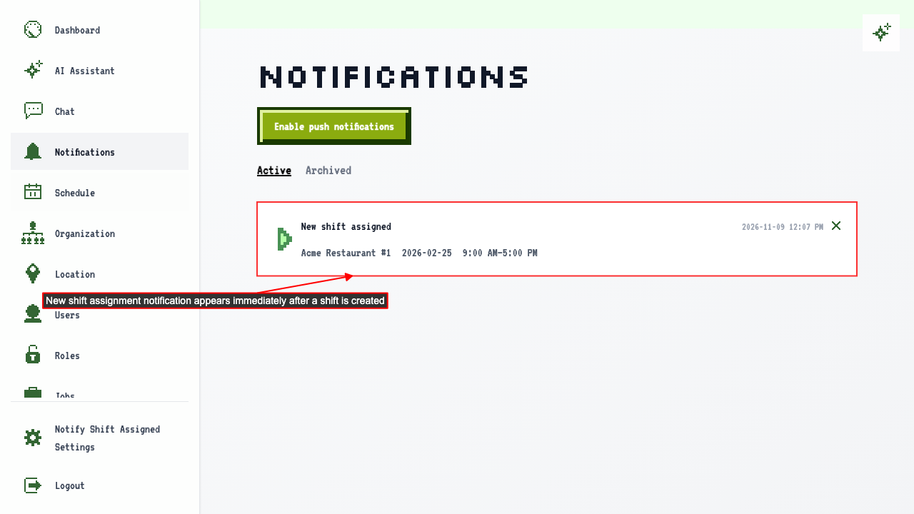
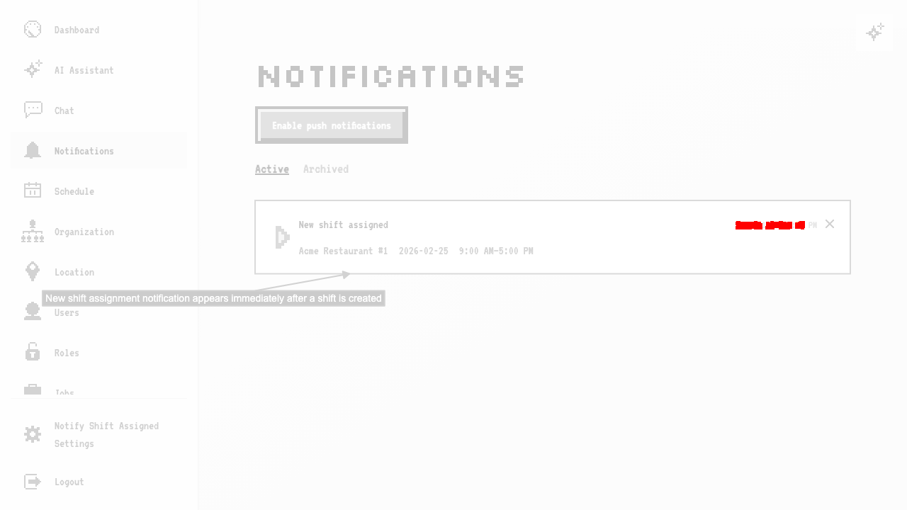
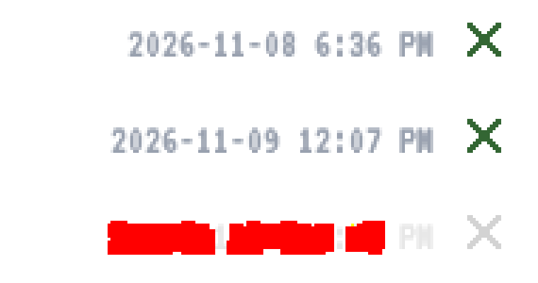
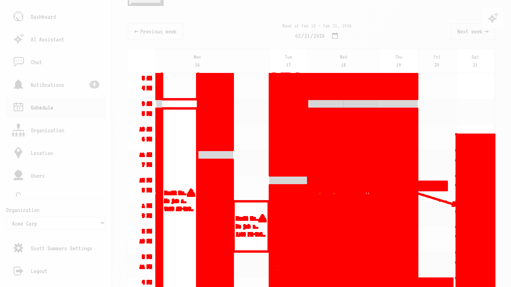

---

slug: diff-detection
title: "Stop Committing Screenshot Noise"
subtitle: "How maxDiffPixelRatio keeps near-identical screenshots out of your git history"
authors: [dethstrobe]
tags: [testing]
---

Every time you regenerate your docs, Test2Doc takes every screenshot again. Most of them look exactly the same as last time. But "looks the same" and "is the same bytes" are different things, so your next commit rewrites hundreds of PNGs and your pull request becomes a wall of binary diffs that nobody can review.

Both `@test2doc/playwright` and `@test2doc/maestro` can now skip the rewrite when a screenshot hasn't really changed. It's an option called `maxDiffPixelRatio`.
{/* truncate */}

## How bad is it?

I have a shift scheduling app called Schedulelord, and its guides are generated by Test2Doc, with a fixed file name for each screenshot. Every so often I regenerate them all and commit the result. I went back through three of those "regenerate the guides" commits and compared each modified screenshot with the version before it, pixel by pixel.

Across the three commits, 719 screenshots were modified:

| How much of the image changed        | Screenshots | Share |
| ------------------------------------ | ----------- | ----- |
| No differing pixels                  | 78          | 11%   |
| 0.1% of the pixels or less           | 424         | 59%   |
| 1% of the pixels or less             | 544         | 76%   |
| More than 1% of the pixels           | 175         | 24%   |

Three quarters of the files in those commits differ by 1% of their pixels or less. Some have no differing pixels at all, as far as pixelmatch can tell, and only differ in the bytes of the PNG file.

## What does a tiny change look like?

Here's one of them, the notifications page from the guide for the new shift notification. The first image is from before the regeneration, and the second is after. I'll save you the trouble of playing spot the difference.




I ran both through [pixelmatch](https://github.com/mapbox/pixelmatch), which is the same library Test2Doc uses now, and drew the differing pixels in red over a faded copy of the screenshot:



That red mark is the timestamp on the notification, and nothing else. Zoomed in, with the old one on top, the new one in the middle, and the diff at the bottom:



210 pixels out of 921,600, which is 0.023% of the image. The screenshot is documenting a notification that appears after a shift is created. Nobody reading the guide cares what time it appeared, but git sees a new 140KB binary.

## The fix

Set `maxDiffPixelRatio` on the reporter. It's the share of pixels, from `0` to `1`, that can differ before a screenshot counts as really changed:

```ts title="playwright-test2doc.config.ts"
reporter: [
  [
    "@test2doc/playwright",
    {
      outputDir: "./doc/docs",
      maxDiffPixelRatio: 0.001, // 0.1% of the pixels
    },
  ],
],
```

Here's what happens when Test2Doc is about to write a screenshot:

1. If there's no file with that name yet, it writes one.
2. If there is, it compares the new screenshot with the one on disk.
3. If no more than `maxDiffPixelRatio` of the pixels differ, it **keeps the old file**.
4. If more differ, or the image is a different size, it replaces the file.

Without the option, nothing changes. Any difference replaces the file, like before.

## Real changes still get through

The same regeneration commit has a screenshot of the week calendar, where the content on the page really did change:



30% of the pixels differ there, which is way over any sensible threshold. It gets replaced, and the new screenshot shows up in the diff, where it belongs.

## Picking a threshold

For my screenshots, here's what each threshold would have kept from the old versions:

| `maxDiffPixelRatio` | Old files kept (of 719) |
| ------------------- | ----------------------- |
| `0` or unset        | 0                       |
| `0.001` (0.1%)      | 424 (59%)               |
| `0.01` (1%)         | 544 (76%)               |

Start low. It's a tradeoff. A real change that's small, like a corrected word or a changed price, can fall under the threshold and get ignored, and your docs would keep showing the old one. The timestamp above is harmless to skip. A wrong number in a table isn't. At 0.1% of a 1280 by 720 screenshot, you'd skip changes of about 900 pixels, which is roughly four timestamps' worth of changed digits like the one above. At 1%, it's about 9,000 pixels.

A few things to know:

- **It only applies to screenshots with a fixed file name.** The default names are a hash of the image, so a changed image is always a new file and there's nothing to compare. Set `filename` in the screenshot's annotation options.
- **It compares against the file on disk, so small changes can add up.** Ten tiny changes in a row never replace the file. If your docs drift, delete the file and regenerate.
- **Out of range values aren't rejected in `@test2doc/playwright` yet.** Use a number from 0 to 1. A `5` keeps every screenshot of the same size.

## Maestro too

`@test2doc/maestro` has the same option in its config file. Screenshots take their fixed name from the label, the same place the annotation options go:

```yaml
- takeScreenshot:
    path: login-screen
    label: 'Login [test2doc_annotation]:{"filename":"login-screen"}'
```

```json title="test2doc-maestro.config.json"
{
  "maxDiffPixelRatio": 0.001
}
```

When a flow runs on several platforms, the platform is added to the name, so you get `login-screen-android.png` and `login-screen-web.png`, and each platform is compared against its own file.

## How I made sure it works

I don't trust screenshot tests that use screenshots I made up. It's too easy to hand-build an image that proves whatever I want, so the test for the Playwright reporter runs a real `playwright test` with the reporter configured like yours. It takes a baseline screenshot in Chromium, then takes another after a tiny change, a color on a 10 by 10 badge, and again after a big one, line spacing that reflows the page. Before it checks what's on disk, it measures how many pixels differ, so a tweak that does nothing or is too big can't make the test pass for the wrong reason.

That check caught me out in CI. My line spacing change moved 1.08% of the pixels on my Mac but only 0.83% in the Linux container, because the fonts are different. My threshold of 1% was right on the edge. The tests now use 0.1%, which is roughly eight to nine times away from both changes, so the fonts don't matter. If you pick a threshold, give it room like that too.

## Try it

Update to `@test2doc/playwright` 1.11.0 or `@test2doc/maestro` 0.2.0, give your screenshots fixed names, and set `maxDiffPixelRatio`. Run your docs generation twice and check `git status`. If it's quiet, it's working. If your screenshots churn in ways my numbers don't cover, I'd like to hear about it.
